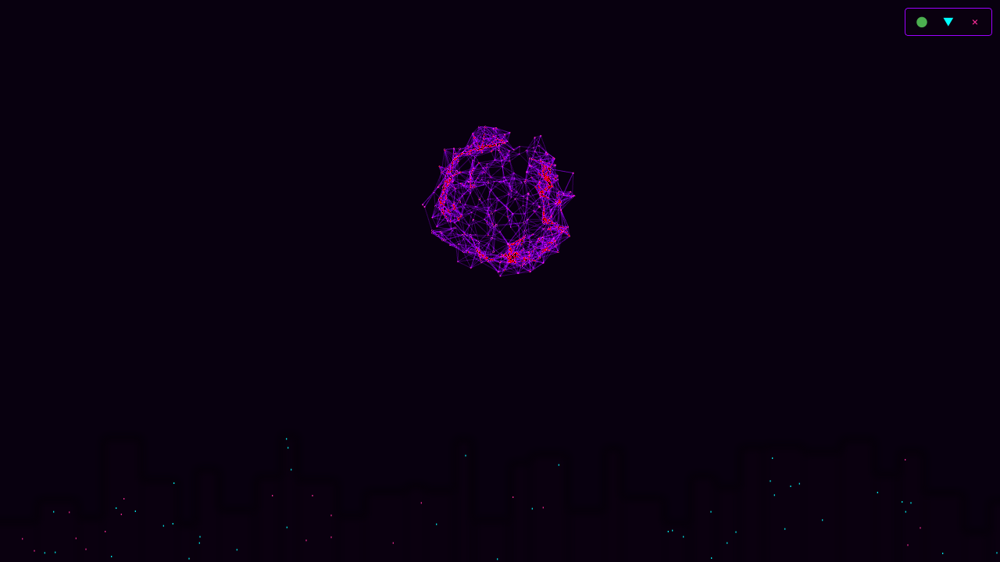

# JarvisUI

A desktop overlay for the open-source voice assistant [Jarvis](https://github.com/isair/jarvis).
It shows the assistant as a glowing 3D point-cloud orb that reacts to what Jarvis is doing
and to your microphone, either as a small click-through widget in the corner of the screen
or as a fullscreen dashboard.

Built with PyQt6 and Three.js (rendered inside a Qt WebEngine view).



## Features

- **Live state**: the orb changes with Jarvis's state, which is parsed from its console output
  - *idle*: slow drift, dim glow
  - *listening*: the orb contracts
  - *thinking*: points flicker
  - *speaking*: the orb expands and glows brighter
- **Microphone reactive**: the input level drives how fast the points drift and how bright the
  connections are
- **Widget mode**: a 100×100 px transparent orb that stays on top and lets clicks pass through.
  It hides itself while a fullscreen game is running (Windows)
- **Fullscreen mode**: a large orb, an animated city skyline and a log panel that types out
  Jarvis's output, plus a power button to stop Jarvis and free GPU memory
- **Process manager**: starts Jarvis as a subprocess, streams its output and restarts it
  automatically if it crashes

## Setup

JarvisUI expects to live in a `jarvis_ui` folder inside a Jarvis checkout that has its
own virtual environment:

```
jarvis/
├── .venv/
├── src/jarvis/...
└── jarvis_ui/        ← this repository
```

```bash
cd jarvis
git clone https://github.com/MinZziGOGOGO/jarvis-setup.git jarvis_ui
.venv/Scripts/pip install -r jarvis_ui/requirements.txt    # Linux/macOS: .venv/bin/pip
```

Start it with `start_jarvis_ui.bat` on Windows, or directly:

```bash
python jarvis_ui/main.py
```

Paths can also be set with environment variables: `JARVIS_PATH` (Jarvis repository),
`JARVIS_PYTHON` (its Python interpreter) and `JARVIS_MIC_DEVICE` (input device index,
see `python -m sounddevice`).

To start JarvisUI with Windows, put a shortcut to `start_jarvis_ui.bat` into the startup
folder (`Win+R` → `shell:startup`).

## Controls

| Key | Action |
|-----|--------|
| `Ctrl+Shift+J` | Switch between widget and fullscreen mode (global hotkey) |
| `L` | Show / hide the log panel (fullscreen) |
| `Esc` | Back to widget mode |
| `Ctrl+Q` | Quit |

## How it works

```
 Jarvis subprocess ──stdout──▶ JarvisProcess ─┐
 Microphone (sounddevice) ───▶ MicListener ───┼─▶ Qt signals ─▶ OrbBridge ─▶ runJavaScript() ─▶ orb.html (Three.js)
 Foreground window (Win32) ──▶ WindowDetector ┘                  LogWidget
```

The microphone, the subprocess reader and the window detector run on background threads.
They never touch Qt widgets directly. Instead they emit Qt signals, which Qt delivers on
the GUI thread. The Python side talks to the Three.js scene with one-way
`runJavaScript("window.setState('speaking')")` calls.

| File | Purpose |
|------|---------|
| `main.py` | Entry point, widget and fullscreen windows, mode switching |
| `orb.html` | Three.js point-cloud orb (Three.js is bundled in `vendor/`, no internet needed) |
| `bridge.py` | Python → JavaScript bridge, queues calls until the page has loaded |
| `jarvis_process.py` | Starts, monitors and restarts the Jarvis subprocess |
| `mic_listener.py` | Smoothed microphone level (RMS) |
| `window_detector.py` | Detects fullscreen apps via the Win32 API |
| `log_widget.py` | Draggable log panel with typewriter effect |
| `generate_skyline.py` | Generates the skyline images in `assets/` |
| `config.py` | Settings |

## Tech stack

Python · PyQt6 / Qt WebEngine · Three.js · sounddevice + NumPy · Win32 API via ctypes
